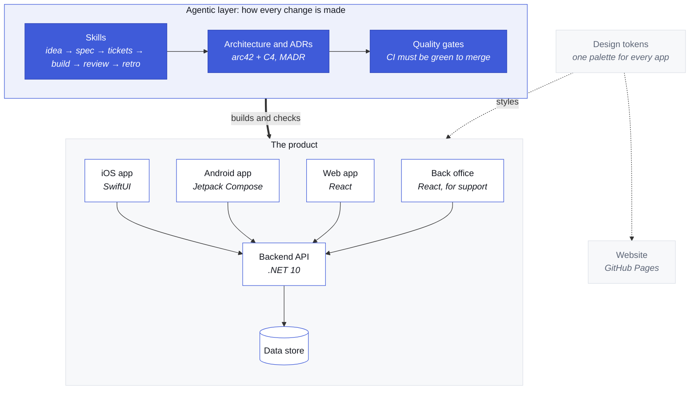

# Agentic Product Starter

A complete, end-to-end business starter for building a product with AI coding agents: **iOS app, Android app, web app, back office, .NET backend and landing website** in one repository, with one design system, one way of working from idea to retro, and quality gates on every change.

Copy it for each new product, rename it, and start shaping your first feature.

## Architecture at a glance



- **The product:** iOS, Android and web apps for customers and a back office for support, all on one .NET API and styled from one set of design tokens.
- **The agentic layer:** skills take every change from idea to retro. Before writing code, agents read the architecture overview and the decisions (ADRs), and CI blocks the merge until every check is green.

| Read | To understand |
|---|---|
| [Architecture overview](docs/architecture/README.md) | The C4 diagrams, building blocks, sign-in and feature-flag flows, environments, risks |
| [Architecture decisions](docs/adr/README.md) | Why it is built this way, one ADR per decision (MADR format) |
| [Skills](.agents/skills/README.md) | Which skill to use at each stage, from idea to retro |

## What's inside

| Folder | What it is | Tech | Status |
|---|---|---|---|
| [`apps/ios`](apps/ios/README.md) | Customer app: sign up, sign in, home, profile, sign out | Swift, SwiftUI | Ready |
| [`apps/android`](apps/android/README.md) | The same customer app on Android | Kotlin, Jetpack Compose, Navigation 3 | Ready |
| [`apps/web-app`](apps/web-app/README.md) | The same customer flow in the browser | React, TypeScript, Vite | Ready |
| [`apps/back-office`](apps/back-office/README.md) | Admin and customer support: find, edit, disable, delete customers; feature flags | React, TypeScript, Vite | Ready |
| [`backend`](backend/README.md) | Accounts, profiles, admin and feature flag APIs | .NET 10, ASP.NET Core | Ready |
| [`apps/website`](apps/website/README.md) | One-page landing site ([live](https://erumkatzwan.github.io/agentic-product-starter/)) | HTML, CSS | Ready |
| [`design`](design/README.md) | One colour palette and set of tokens for every app, Figma-ready | Design tokens (JSON) | Ready |
| [`docs/`](docs/README.md) | Product context, [architecture overview](docs/architecture/README.md) (arc42 + C4), [decisions](docs/adr/README.md) (MADR), agent setup | Markdown | Ready |
| `.agents/skills/` | 27 shared skills covering the whole SDLC | Agent Skills | Ready |

```
/
├── AGENTS.md                # Shared agent rules; points to each component's AGENTS.md
├── CLAUDE.md                # Loads AGENTS.md for Claude Code
├── .agents/skills/          # Shared skills: idea → spec → tickets → build → review → retro
├── .github/                 # CI workflows, issue templates
├── apps/
│   ├── ios/                 # Customer app for iPhone (SwiftUI)
│   ├── android/             # Customer app for Android (Jetpack Compose)
│   ├── web-app/             # Customer web app (React)
│   ├── back-office/         # Admin and support tool (React)
│   └── website/             # One-page landing site
├── backend/                 # API for every app (.NET)
├── design/                  # tokens.json (single source of truth) + generator
└── docs/
    ├── product/             # Vision, roadmap, personas
    ├── architecture/        # Architecture overview (arc42 + C4 diagrams)
    ├── adr/                 # Architecture decision records (MADR)
    └── agents/              # How the shared skills use this repo
```

Each component has its own `README.md`, `AGENTS.md` and `.agents/skills/`.

## Screenshots

| | Sign in | Home | Detail | Profile |
|---|---|---|---|---|
| **iOS** |  |  |  |  |
| **Android** |  |  |  |  |

| Web app | Back office |
|---|---|
|  |  |

Same flow, same palette, every app. The pictures are taken by the [Screenshots workflow](.github/workflows/screenshots.yml) from the SYST builds with test data and refresh automatically whenever an app changes.

## One flow, every app

| | iOS | Android | Web app | Back office |
|---|---|---|---|---|
| Sign up | ✓ | ✓ | ✓ | – |
| Sign in / sign out | ✓ | ✓ | ✓ | ✓ (admins only) |
| Profile: edit name, delete account | ✓ | ✓ | ✓ | – |
| Find, edit, disable, delete customers | – | – | – | ✓ |
| Feature flags | read | read | read | read and switch |

All of them talk to the same backend endpoints and read the same feature flags.

## One design system

`design/tokens.json` holds the colour palette, spacing, type and radius. `node design/build.mjs` generates CSS variables for the web app, back office and website, `DesignTokens.swift` for iOS and `DesignTokens.kt` for Android. CI fails if any app drifts from the palette. The file follows the W3C Design Tokens format, so it can be linked to Figma later with Tokens Studio. See [design/README.md](design/README.md).

## The agentic SDLC

| Stage | Shared skills | Where it lands |
|---|---|---|
| 1. Shape the idea | `grill-me`, `wayfinder`, `research`, `prototype` | `docs/product/`, decision notes |
| 2. Refine | `grill-with-docs`, `domain-modeling`, `architecture-decisions` | `GLOSSARY.md`, MADR ADRs in `docs/adr/`, `docs/architecture/` |
| 3. Specify | `to-spec` | A spec in GitHub Issues |
| 4. Plan | `to-tickets`, `triage` | Agent-ready tickets with labels |
| 5. Build | `architecture-decisions` (read first), `implement` / `implement-spec`, `tdd` + platform skills | A branch with code and tests |
| 6. Review | `code-review`, `pr` | A pull request; all checks must be green |
| 7. Fix and improve | `diagnosing-bugs`, `improve-codebase-architecture` | Fixes and refactor proposals |
| 8. Learn | `retro`, `handoff` | Better skills, checks and `AGENTS.md` |

Platform skills tell the agent how to build on each platform: `apps/ios/.agents/skills/`, `apps/android/.agents/skills/`, `apps/web-app/.agents/skills/`, `apps/back-office/.agents/skills/`, `backend/.agents/skills/`, `apps/website/.agents/skills/`. Details: [.agents/skills/README.md](.agents/skills/README.md).

## Quality gates

Every pull request runs the checks for the parts it touches:

| Component | Checks |
|---|---|
| iOS | Lint, spelling, unit tests + 70% coverage, UI tests, end-to-end (Maestro) |
| Android | ktlint + Android Lint, spelling, build of every environment, unit tests + 70% coverage, Compose UI tests and end-to-end (Maestro) on an emulator |
| Web app / back office | Lint, types, spelling, unit tests + 70% coverage, end-to-end (Playwright) against the real backend |
| Backend | Format, build with warnings as errors, unit + integration tests, 70% coverage |
| Website | HTML validation, spelling, smoke tests |
| Design tokens | Generated files in sync with `design/tokens.json` |
| Security | Dependency review on every pull request, CodeQL, secret push protection, weekly vulnerability report across all apps ([SECURITY.md](SECURITY.md)) |
| Dependencies | Dependabot: grouped patch and minor updates per app merge automatically when CI is green |

## Environments

Every component uses **Dev**, **SYST** (system test) and **Prod**. Dev and SYST seed two accounts: `admin@example.com` / `Admin123!` and `customer@example.com` / `Customer123!`.

## Make it yours

Turn the starter into your product in one command. It renames every app, bundle ID, package, namespace and folder, and keeps the credits:

```bash
node scripts/rename.mjs --name "Fashion Girl" --id com.fashiongirl.app --dry-run   # preview
node scripts/rename.mjs --name "Fashion Girl" --id com.fashiongirl.app             # apply
```

Or ask your agent: "Rename this product to Fashion Girl" (the `rename-product` skill). Start from **Use this template** on GitHub to get your own copy first.

## Getting started

```bash
# 1. Backend
cd backend && dotnet run --project src/AgenticProduct.Api --launch-profile Dev

# 2. Web app (new terminal)
cd apps/web-app && npm install && npm run dev          # http://localhost:5173

# 3. Back office (new terminal)
cd apps/back-office && npm install && npm run dev      # http://localhost:5174

# 4. iOS: see apps/ios/README.md
# 5. Android: see apps/android/README.md
```

Then open the repo in Claude Code and run `/grill-me` on your first idea.

## Credits

- **Agentic Product Starter** by [Erum Awan](https://github.com/erumkatzwan): the product starter, apps, backend, design system, quality gates and how they fit together.
- **Shared agent skills** by [Matt Pocock](https://github.com/mattpocock), from [mattpocock/skills](https://github.com/mattpocock/skills) ([aihero.dev/skills](https://www.aihero.dev/skills)), used under the MIT licence. See `.agents/skills/LICENSE-mattpocock-skills`.
- **iOS community skills** by [Antoine van der Lee](https://github.com/AvdLee) (SwiftUI, Swift Concurrency, Swift Testing), used under the MIT licence.
- **Architecture formats:** [MADR](https://adr.github.io/madr/) (MIT / CC0), [arc42](https://arc42.org) and the [C4 model](https://c4model.com). Interactive diagrams with the optional [Archify](https://github.com/tt-a1i/archify) skill by tt-a1i (Apache 2.0), installed on demand.
- **Android skills** by Google, from [android/skills](https://github.com/android/skills) (Navigation 3, edge-to-edge, Compose performance, testing, AGP 9, R8, Credential Manager, security), used under the Apache 2.0 licence.

## License

[MIT](LICENSE) © Erum Awan. Use it, copy it and build on it; just keep the licence notice. The included shared skills by Matt Pocock and the iOS community skills by Antoine van der Lee keep their own MIT licences, and Google's Android skills keep their Apache 2.0 licence.

## Like it? Found something?

- ⭐ **If the setup works for you,** give the repo a star and share it with someone building products with AI agents.
- 🐛 **Found a bug or something unclear?** [Open an issue](https://github.com/erumkatzwan/agentic-product-starter/issues/new/choose) with the **Bug report** template.
- 💡 **Have a suggestion?** [Open an issue](https://github.com/erumkatzwan/agentic-product-starter/issues/new/choose) with the **Suggestion** template.
- 🤝 **Want to contribute or swap ideas?** Say hello in [Discussions](https://github.com/erumkatzwan/agentic-product-starter/discussions). Pull requests are closed for now, so start there and we can take it from there.
- 👋 **Connect with me** on [LinkedIn](https://www.linkedin.com/in/erumkatzwan/).
