# Agentic Product Starter

[](https://github.com/erumkatzwan/agentic-product-starter/actions/workflows/ios.yml)
[](https://github.com/erumkatzwan/agentic-product-starter/actions/workflows/android.yml)
[](https://github.com/erumkatzwan/agentic-product-starter/actions/workflows/web-app.yml)
[](https://github.com/erumkatzwan/agentic-product-starter/actions/workflows/backend.yml)
[](docs/adr/0011-accessibility.md)
[](https://github.com/erumkatzwan/agentic-product-starter/releases)
[](LICENSE)
[](https://github.com/new?template_name=agentic-product-starter&template_owner=erumkatzwan)

**The agentic product foundation.** Mobile, web, back office and backend, with the whole agentic SDLC in one place: AI agent skills from idea to retro, quality gates, security scanning, observability, accessibility and DORA metrics. One repository holds an **iOS app, Android app, web app, back office, .NET backend and landing website**, with one design system and quality gates on every change.

Click **Use this template**, run two setup commands, and start shaping your first feature with the coding agent you already use (Claude Code, Codex, Cursor, GitHub Copilot or any agent that reads `AGENTS.md`). Start at [Make it yours](#make-it-yours).

> Built by human experience and AI together: Claude working alongside 18+ years of engineering leadership. Skip the setup, save time and tokens, and put your energy into creating value with the product you are actually building.

**Live:** [Website](https://erumkatzwan.github.io/agentic-product-starter/) · [Delivery performance dashboard (DORA)](https://erumkatzwan.github.io/agentic-product-starter/dora/)

## Built for

What is ready today, and what you add on top for your business model.

| Business model | Ready today | You add |
|---|---|---|
| **Consumer products (B2C)** | Sign up and sign in, profiles, iOS, Android and web apps, a back office for support, feature flags, Dev/SYST/Prod | Your product's features, and payments if you need them |
| **Business products (B2B)** | Accounts, an admin back office, security scanning and quality gates | Organisations and teams, invites, roles and permissions, single sign-on (for example Entra ID), separate data per company, billing |
| **Partner platforms (B2B2C)** | The same foundation as B2B | Everything for B2B, plus a partner layer: each partner's own branding, customers and data |

**Good fits:** mobile-first apps, SaaS web apps, customer portals with an admin back office, and internal tools. **Not included yet:** payments, organisations, single sign-on and multi-tenancy. Build them with the same skills and quality gates, starting with the `to-spec` skill.

## Screenshots

| | Sign in | Home | Detail | Profile |
|---|---|---|---|---|
| **iOS** | 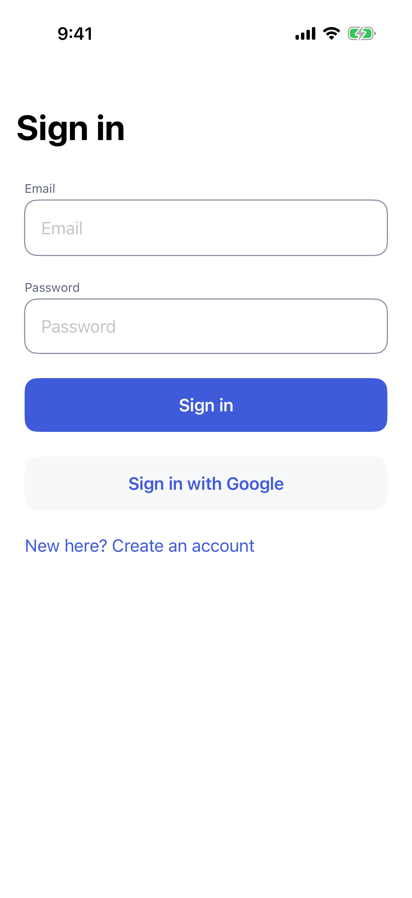 | 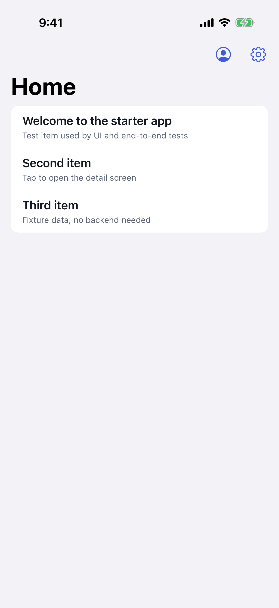 | 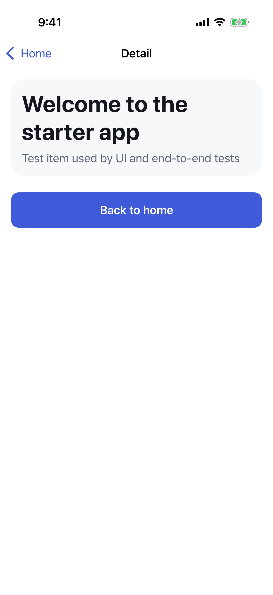 | 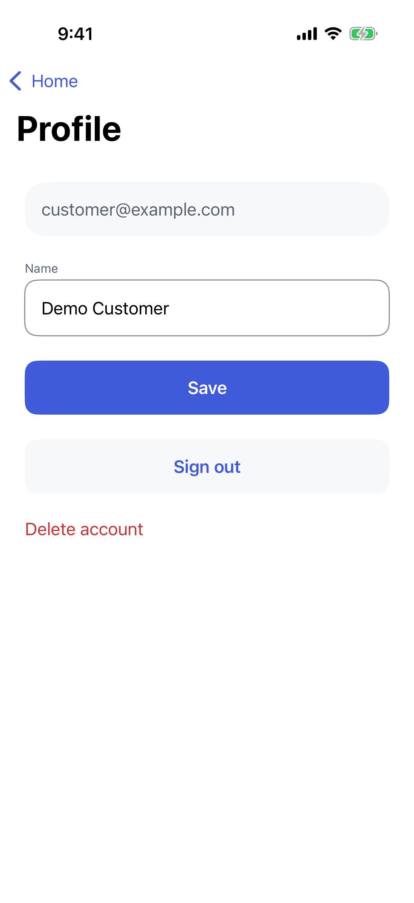 |
| **Android** | 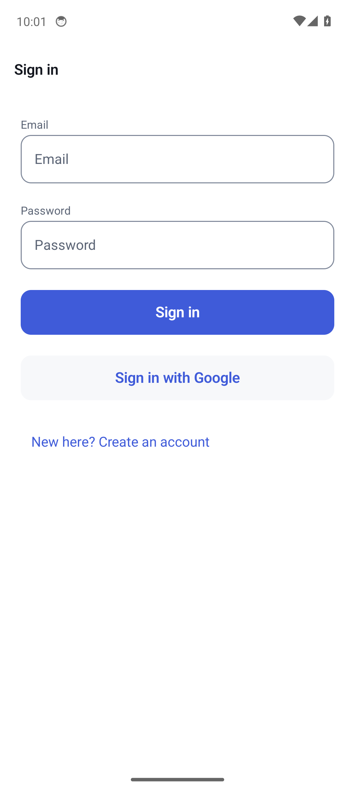 | 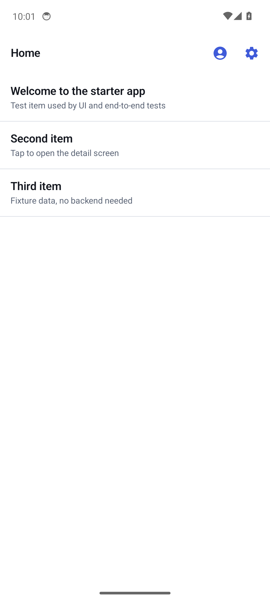 | 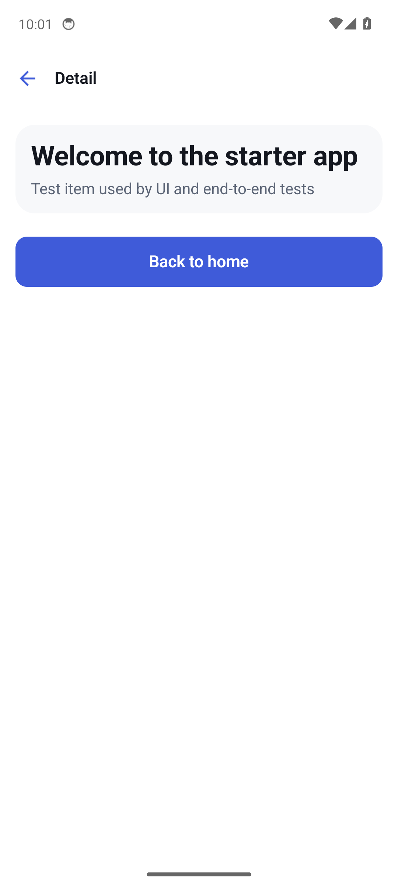 | 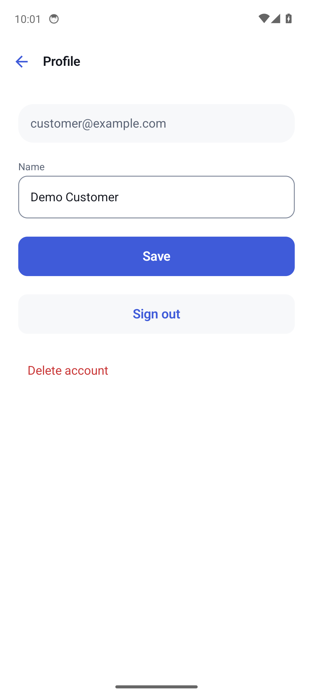 |

| Web app | Back office |
|---|---|
| 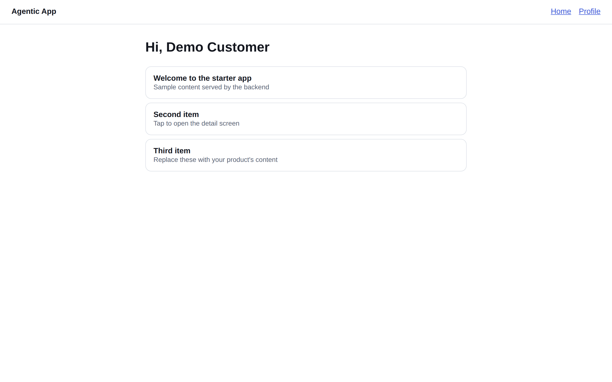 | 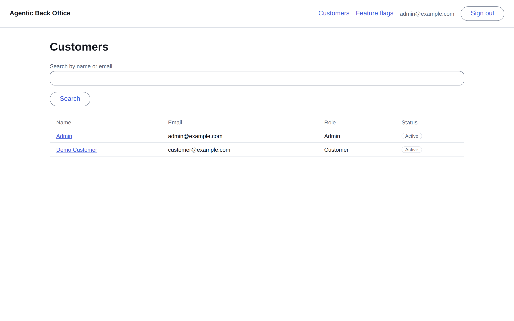 |

Same flow, same palette, every app. The pictures are taken by the [Screenshots workflow](.github/workflows/screenshots.yml) from the SYST builds with test data and refresh automatically whenever an app changes.

## Production-ready from day one

| Area | What you get |
|---|---|
| **Apps** | iOS, Android, web app, back office, .NET 10 backend and landing website, all on one backend and one sign-in flow |
| **Design** | One token file generates Swift, Kotlin and CSS; CI blocks any app that drifts from the palette |
| **Way of working** | 35 shared skills from idea to retro, platform skills for every app, `AGENTS.md` rules for any coding agent |
| **Architecture** | arc42 overview with C4 diagrams and MADR decision records, read before every change |
| **Quality gates** | Lint, types, spelling, unit, UI and end-to-end tests with 70% coverage on every pull request; `main` only changes through green pull requests |
| **Environments** | Dev, SYST and Prod in every app, plus feature flags to ship unfinished work safely |
| **Security** | CodeQL, dependency review, secret push protection, private vulnerability reporting and a weekly vulnerability report across all apps |
| **Dependencies** | Dependabot every week; patch and minor updates merge themselves when CI is green, major ones are reviewed |
| **Accessibility** | WCAG 2.2 AA in every app: colour contrast checked in the design tokens (light and dark), axe on every web screen, Apple's and Google's accessibility audits in the iOS and Android UI tests |
| **Observability** | OpenTelemetry traces, metrics and logs from the backend into Grafana dashboards, with a one-command local stack; crash reporting in every app with Sentry; CI proves the data arrives |
| **Delivery metrics** | The four DORA keys measured weekly from GitHub and shown on a [live dashboard](https://erumkatzwan.github.io/agentic-product-starter/dora/) |
| **Make it yours** | One command applies the GitHub settings a template copy misses, one renames every app, ID, package and folder; CI proves both |
| **Third-party services** | Sentry, Grafana Cloud and store accounts are all optional and off until you add a key; one list says what each needs and where the values go |
| **Screenshots** | Taken from the real apps and refreshed automatically |

## Make it yours

Four steps from this starter to your own product. Only the first three are needed to build and run everything; nothing needs an account or a key.

### 1. Copy it

Click **Use this template** on GitHub and create your repository.

### 2. Turn on the GitHub settings

GitHub's **Use this template** copies the files but not the repository's settings, so a new copy starts unprotected: anyone can push to `main` and no check is required. `config/repo-settings.json` is a written copy of this repository's settings, and one command applies it to your copy through the GitHub CLI, signed in as you (GitHub may ask you to confirm with your passkey). It turns on: branch protection with every required check, squash-only merges, auto-merge, CodeQL, Dependabot, secret scanning, private vulnerability reporting, GitHub Pages, the Dev/Syst/Prod environments and the labels the skills use.

```bash
gh auth login                                   # once, as an admin of your new repository
node scripts/setup.mjs repo --dry-run           # see what it will change
node scripts/setup.mjs repo                     # apply (config/repo-settings.json)
```

**Accessibility checks are on by default** (WCAG 2.2 AA, [ADR-0011](docs/adr/0011-accessibility.md)). If you cannot meet them yet, run `node scripts/setup.mjs repo --accessibility off`, or set the repository variable `ACCESSIBILITY_CHECKS` to `off` in **Settings → Secrets and variables → Actions**. The checks then skip instead of blocking merges; set it back to `on` when you are ready.

Steps GitHub refuses (for example, a feature that needs a paid plan on a private repository) are listed so you can set them by hand in **Settings**. If you later change a setting by hand, update `config/repo-settings.json` too, so the next copy gets it.

### 3. Rename it

One command renames every app, bundle ID, package, namespace and folder, and keeps the credits:

```bash
node scripts/rename.mjs --name "Fashion Girl" --id com.fashiongirl.app --dry-run   # preview
node scripts/rename.mjs --name "Fashion Girl" --id com.fashiongirl.app             # apply
```

Or ask your agent: "Rename this product to Fashion Girl" (the `rename-product` skill).

### 4. Connect third-party services (optional)

Every service below is **off until you add its key**, and the product builds, runs and passes CI without any of them. Run `node scripts/setup.mjs` to see what is on and how to turn the rest on, or ask your agent to "set up integrations" (the `setup-integrations` skill).

| Service | What it adds | When | Cost | Settings |
|---|---|---|---|---|
| [Sentry](https://sentry.io) | Crash and error reports from iOS, Android, web app and back office | Optional | Free plan | `SENTRY_DSN_IOS`, `SENTRY_DSN_ANDROID`, `SENTRY_DSN_WEB_APP`, `SENTRY_DSN_BACK_OFFICE` |
| [Grafana Cloud](https://grafana.com/products/cloud/) | Backend traces, metrics and logs in SYST and Prod (Dev runs Grafana locally) | Optional | Free tier | `OTEL_EXPORTER_OTLP_ENDPOINT`, `OTEL_EXPORTER_OTLP_HEADERS` |
| [Apple Developer Program](https://developer.apple.com/programs/) | Running on a phone, TestFlight, App Store, push notifications | When you publish | Yearly fee | Team ID, bundle IDs, APNs key |
| [Google Play](https://play.google.com/console) and Firebase | Publishing on Android, push notifications | When you publish | One-off fee; push is free | Application ID, `google-services.json` |
| Hosting | Running the API, web app and back office for customers | When you publish | Depends on the provider | API addresses per environment |

Where the values go (never in the code):

* **Your machine (Dev):** copy `.env.example` to `.env.local` at the repository root. It is git-ignored, and every app reads it when it builds.
* **SYST and Prod:** GitHub Environments. `node scripts/setup.mjs set SENTRY_DSN_IOS --env Prod` saves a value there (secrets stay hidden); deploy workflows that use the environment receive it as an environment variable.

The full list, with sign-up links and step-by-step instructions, is `config/integrations.json`. The **Setup check** fails if a setting is added to the code without being listed there.

## Run it locally

What to install (the versions CI uses):

| For | Install |
|---|---|
| Backend | [.NET 10 SDK](https://dotnet.microsoft.com/download) |
| Web app, back office, website, scripts | [Node.js 22](https://nodejs.org) |
| iOS app | Xcode 16 or newer on a Mac, then `make bootstrap` in `apps/ios` (XcodeGen, SwiftLint, Maestro) |
| Android app | [Android Studio](https://developer.android.com/studio) (latest stable; includes JDK 21 and the SDK) |
| Dashboards (optional) | [Docker](https://www.docker.com/products/docker-desktop/) |

```bash
# Backend
cd backend && dotnet run --project src/AgenticProduct.Api --launch-profile Dev

# Web app (new terminal)
cd apps/web-app && npm install && npm run dev          # http://localhost:5173

# Back office (new terminal)
cd apps/back-office && npm install && npm run dev      # http://localhost:5174

# Optional: dashboards at http://localhost:3000
docker compose -f observability/docker-compose.yml up -d

# iOS: see apps/ios/README.md
# Android: see apps/android/README.md
```

Sign in with `customer@example.com` / `Customer123!`. Then open the repository in your coding agent and ask it to grill you on your first idea (the `grill-me` skill; `/grill-me` in Claude Code).

## Delivery performance

How fast and how safely changes reach `main`, measured every Monday with the four [DORA](https://dora.dev) metrics and published on a [live dashboard](https://erumkatzwan.github.io/agentic-product-starter/dora/).

<a href="https://erumkatzwan.github.io/agentic-product-starter/dora/">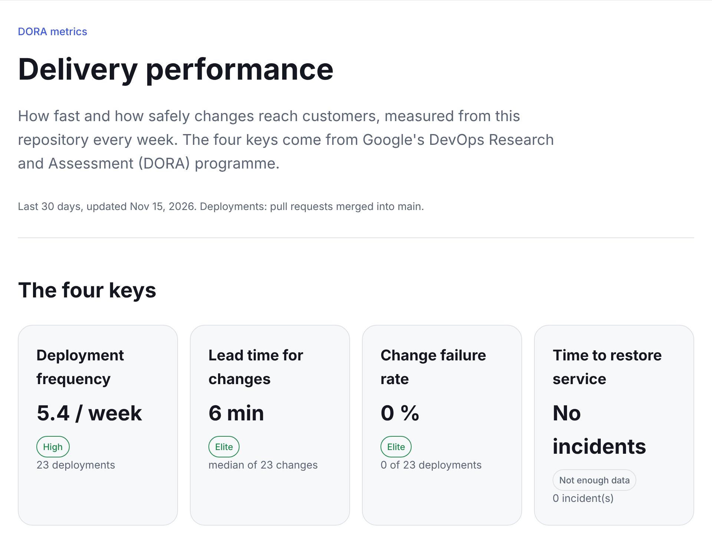</a>

The picture is a snapshot; the dashboard shows the latest numbers and their trend. Every copy of the starter gets its own dashboard. See [ADR-0010](docs/adr/0010-dora-metrics.md) and the `dora-metrics` skill.

## Architecture at a glance

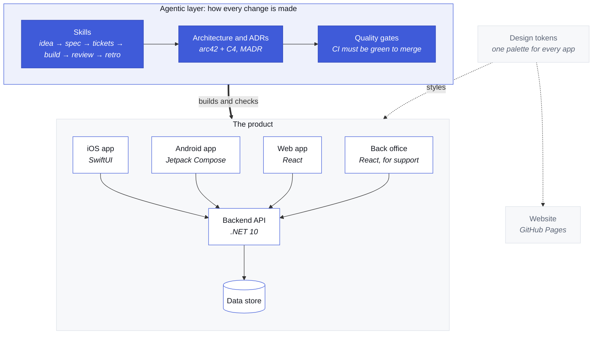

- **The product:** iOS, Android and web apps for customers and a back office for support, all on one .NET API and styled from one set of design tokens.
- **The agentic layer:** skills take every change from idea to retro. Before writing code, agents read the architecture overview and the decisions (ADRs), and CI blocks the merge until every check is green.

| Read | To understand |
|---|---|
| [Architecture overview](docs/architecture/README.md) | The C4 diagrams, building blocks, sign-in and feature-flag flows, environments, risks |
| [Architecture decisions](docs/adr/README.md) | Why it is built this way, one ADR per decision (MADR format) |
| [Skills](.agents/skills/README.md) | Which skill to use at each stage, from idea to retro |

## What's inside

| Folder | What it is | Tech | Status |
|---|---|---|---|
| [`apps/ios`](apps/ios/README.md) | Customer app: sign up, sign in, home, profile, sign out | Swift, SwiftUI | Ready |
| [`apps/android`](apps/android/README.md) | The same customer app on Android | Kotlin, Jetpack Compose, Navigation 3 | Ready |
| [`apps/web-app`](apps/web-app/README.md) | The same customer flow in the browser | React, TypeScript, Vite | Ready |
| [`apps/back-office`](apps/back-office/README.md) | Admin and customer support: find, edit, disable, delete customers; feature flags | React, TypeScript, Vite | Ready |
| [`backend`](backend/README.md) | Accounts, profiles, admin and feature flag APIs | .NET 10, ASP.NET Core | Ready |
| [`apps/website`](apps/website/README.md) | Landing site ([live](https://erumkatzwan.github.io/agentic-product-starter/)) and [delivery dashboard](https://erumkatzwan.github.io/agentic-product-starter/dora/) | HTML, CSS | Ready |
| [`observability`](observability/README.md) | Local Grafana stack, dashboards, and how to connect Grafana Cloud and Sentry | OpenTelemetry, Grafana, Sentry | Ready |
| [`design`](design/README.md) | One colour palette and set of tokens for every app, Figma-ready | Design tokens (JSON) | Ready |
| [`docs/`](docs/README.md) | Product context, [architecture overview](docs/architecture/README.md) (arc42 + C4), [decisions](docs/adr/README.md) (MADR), agent setup | Markdown | Ready |
| `.agents/skills/` | 35 shared skills covering the whole SDLC | Agent Skills | Ready |

```
/
├── AGENTS.md                # Shared agent rules; points to each component's AGENTS.md
├── .env.example             # Local third-party settings (copy to .env.local)
├── CLAUDE.md                # Loads AGENTS.md for Claude Code
├── .agents/skills/          # Shared skills: idea → spec → tickets → build → review → retro
├── .github/                 # CI workflows, issue templates
├── config/                  # Third-party services and GitHub settings for new copies
├── apps/
│   ├── ios/                 # Customer app for iPhone (SwiftUI)
│   ├── android/             # Customer app for Android (Jetpack Compose)
│   ├── web-app/             # Customer web app (React)
│   ├── back-office/         # Admin and support tool (React)
│   └── website/             # Landing site and DORA dashboard
├── backend/                 # API for every app (.NET)
├── design/                  # tokens.json (single source of truth) + generator
├── observability/           # Local Grafana stack and dashboards (OpenTelemetry)
└── docs/
    ├── product/             # Vision, roadmap, personas
    ├── architecture/        # Architecture overview (arc42 + C4 diagrams)
    ├── adr/                 # Architecture decision records (MADR)
    └── agents/              # How the shared skills use this repo
```

Each component has its own `README.md`, `AGENTS.md` and `.agents/skills/`.

## One flow, every app

| | iOS | Android | Web app | Back office |
|---|---|---|---|---|
| Sign up | ✓ | ✓ | ✓ | – |
| Sign in / sign out | ✓ | ✓ | ✓ | ✓ (admins only) |
| Profile: edit name, delete account | ✓ | ✓ | ✓ | – |
| Find, edit, disable, delete customers | – | – | – | ✓ |
| Feature flags | read | read | read | read and switch |

All of them talk to the same backend endpoints and read the same feature flags.

## One design system

`design/tokens.json` holds the colour palette, spacing, type and radius. `node design/build.mjs` generates CSS variables for the web app, back office and website, `DesignTokens.swift` for iOS and `DesignTokens.kt` for Android. CI fails if any app drifts from the palette. The file follows the W3C Design Tokens format, so it can be linked to Figma later with Tokens Studio. See [design/README.md](design/README.md).

## The agentic SDLC

The stages follow the ideas in Anthropic's [AI-native SDLC playbook](https://claude.com/resources/articles/the-ai-native-sdlc-playbook): written intent before code, skills for repeatable work, an agent guide (`AGENTS.md` / `CLAUDE.md`), layered review by agents and people, and automated checks as the gate to `main`.

| Stage | Shared skills | Where it lands |
|---|---|---|
| 1. Shape the idea | `grill-me`, `wayfinder`, `research`, `prototype` | `docs/product/`, decision notes |
| 2. Refine | `grill-with-docs`, `domain-modeling`, `architecture-decisions` | `GLOSSARY.md`, MADR ADRs in `docs/adr/`, `docs/architecture/` |
| 3. Specify | `to-spec` | A spec in GitHub Issues |
| 4. Plan | `to-tickets`, `triage` | Agent-ready tickets with labels |
| 5. Build | `architecture-decisions` (read first), `implement` / `implement-spec`, `tdd` + platform skills | A branch with code and tests |
| 6. Review | `code-review`, `pr` | A pull request; all checks must be green |
| 7. Fix and improve | `diagnosing-bugs`, `improve-codebase-architecture` | Fixes and refactor proposals |
| 8. Learn | `retro`, `handoff`, `dora-metrics` | Better skills, checks and `AGENTS.md`; delivery trends on the DORA dashboard |

Platform skills tell the agent how to build on each platform: `apps/ios/.agents/skills/`, `apps/android/.agents/skills/`, `apps/web-app/.agents/skills/`, `apps/back-office/.agents/skills/`, `backend/.agents/skills/`, `apps/website/.agents/skills/`. Details: [.agents/skills/README.md](.agents/skills/README.md).

## Quality gates

Every pull request runs only the checks for the parts it touches: Markdown-only changes (READMEs, `AGENTS.md`, skills) never start a build, a backend change re-runs only the web end-to-end tests, and the slow simulator and emulator jobs run side by side. A check that has nothing to do reports as skipped, which counts as passed, so `main` stays protected.

| Component | Checks |
|---|---|
| iOS | Lint, spelling, unit tests + 70% coverage, UI tests, end-to-end (Maestro) |
| Android | ktlint + Android Lint, spelling, build of every environment, unit tests + 70% coverage, Compose UI tests and end-to-end (Maestro) on an emulator |
| Web app / back office | Lint, types, spelling, unit tests + 70% coverage, end-to-end (Playwright) against the real backend |
| Backend | Format, build with warnings as errors, unit + integration tests, 70% coverage |
| Website | HTML validation, spelling, smoke tests |
| Design tokens | Generated files in sync with `design/tokens.json` |
| Security | Dependency review on every pull request, CodeQL, secret push protection, weekly vulnerability report across all apps ([SECURITY.md](SECURITY.md)) |
| Setup | Integration list, `.env.example`, repository settings and code agree |
| Accessibility | WCAG 2.2 AA: token contrast, axe on every web screen (unit and end-to-end, light and dark), iOS accessibility audit, Android Accessibility Test Framework ([ADR-0011](docs/adr/0011-accessibility.md)); on by default, switch off with the `ACCESSIBILITY_CHECKS` variable |
| Observability | Starts Grafana in CI, sends traffic to the API, and fails if metrics, traces or any dashboard query come back empty |
| Dependencies | Dependabot: grouped patch and minor updates per app merge automatically when CI is green |

## Environments

Every component uses **Dev**, **SYST** (system test) and **Prod**. Dev and SYST seed two accounts: `admin@example.com` / `Admin123!` and `customer@example.com` / `Customer123!`.

## Built with it

Products started from the Agentic Product Starter. Built something with it? [Share it](https://github.com/erumkatzwan/agentic-product-starter/issues/new?template=built-with-it.yml) and it can be listed here.

*Be the first: nothing listed yet.*

Copies made with `scripts/rename.mjs` carry a small **Built with Agentic Product Starter** badge in their README, so they are easy to find.

## Credits

- **The way of working** builds on Anthropic's [The AI-native SDLC playbook](https://claude.com/resources/articles/the-ai-native-sdlc-playbook) (August 2026), which describes how teams plan, design, build, test, deploy and maintain software with AI agents. This starter is an independent, ready-to-use implementation of those ideas; it is not made or endorsed by Anthropic.
- **Agentic Product Starter** by [Erum Awan](https://github.com/erumkatzwan): the product starter, apps, backend, design system, quality gates and how they fit together.
- **Shared agent skills** by [Matt Pocock](https://github.com/mattpocock), from [mattpocock/skills](https://github.com/mattpocock/skills) ([aihero.dev/skills](https://www.aihero.dev/skills)), used under the MIT licence. See `.agents/skills/LICENSE-mattpocock-skills`.
- **iOS community skills** by [Antoine van der Lee](https://github.com/AvdLee) (SwiftUI, Swift Concurrency, Swift Testing), used under the MIT licence.
- **Architecture formats:** [MADR](https://adr.github.io/madr/) (MIT / CC0), [arc42](https://arc42.org) and the [C4 model](https://c4model.com). Interactive diagrams with the optional [Archify](https://github.com/tt-a1i/archify) skill by tt-a1i (Apache 2.0), installed on demand.
- **Android skills** by Google, from [android/skills](https://github.com/android/skills) (Navigation 3, edge-to-edge, Compose performance, testing, AGP 9, R8, Credential Manager, security), used under the Apache 2.0 licence.

## License

[MIT](LICENSE) © Erum Awan. Use it, copy it and build on it; just keep the licence notice. The included shared skills by Matt Pocock and the iOS community skills by Antoine van der Lee keep their own MIT licences, and Google's Android skills keep their Apache 2.0 licence.

## Like it? Found something?

- ⭐ **If the setup works for you,** give the repo a star and share it with someone building products with AI agents.
- 🐛 **Found a bug or something unclear?** [Open an issue](https://github.com/erumkatzwan/agentic-product-starter/issues/new/choose) with the **Bug report** template.
- 💡 **Have a suggestion?** [Open an issue](https://github.com/erumkatzwan/agentic-product-starter/issues/new/choose) with the **Suggestion** template.
- 🤝 **Want to contribute or swap ideas?** Say hello in [Discussions](https://github.com/erumkatzwan/agentic-product-starter/discussions). Pull requests are closed for now, so start there and we can take it from there.
- 👋 **Connect with me** on [LinkedIn](https://www.linkedin.com/in/erumkatzwan/).

## Star history

[](https://star-history.com/#erumkatzwan/agentic-product-starter&Date)

---

*“AI gives you answers. Wisdom knows which questions matter.”*
