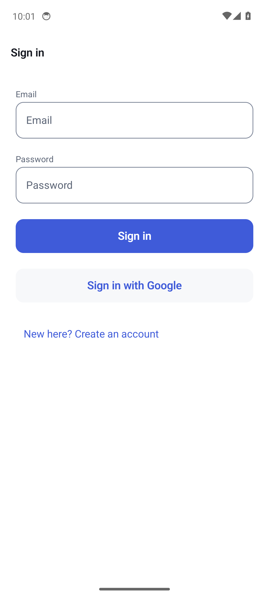
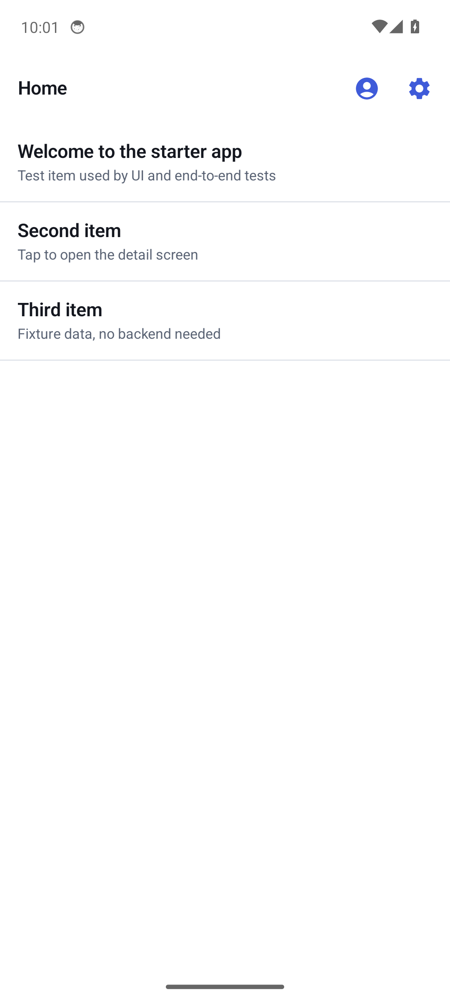
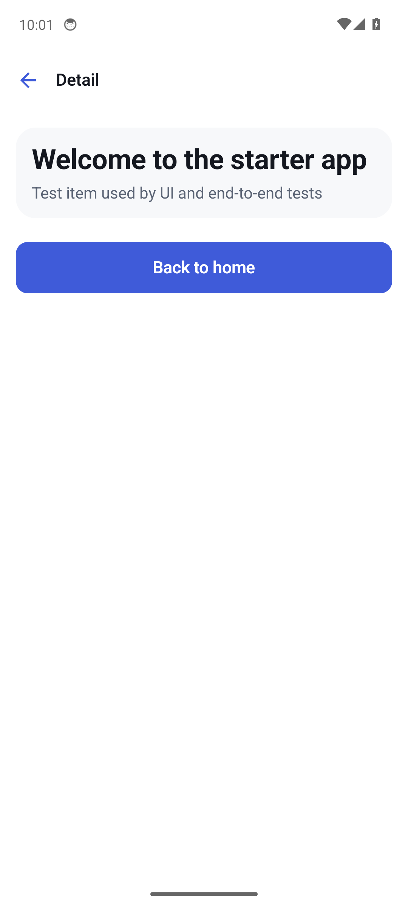
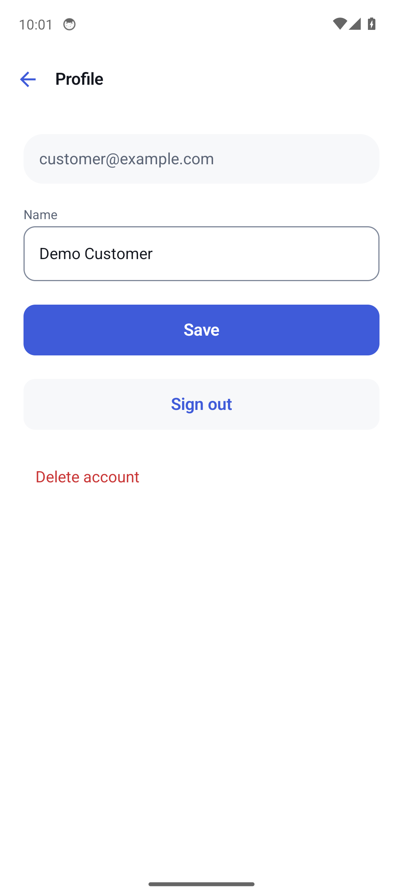
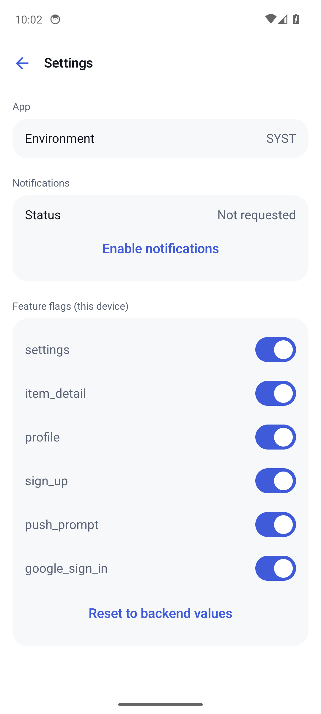

# Android app – tutorial

Part of the [Agentic Product Starter](../../README.md).

Jetpack Compose app with sign up, sign in, profile and sign out against the .NET backend, the shared design tokens, Navigation 3, a REST API layer, feature flags, push notifications, a Google sign-in skeleton, and unit, UI and end-to-end tests gated by CI. It mirrors the [iOS app](../ios/README.md) screen for screen.

## Screenshots

| Sign in | Home | Detail | Profile | Settings |
|---|---|---|---|---|
|  |  |  |  |  |

Taken automatically by the [Screenshots workflow](../../.github/workflows/screenshots.yml) from the SYST build with test data; they refresh whenever the app changes.

## 1. One-time setup

1. Install [Android Studio](https://developer.android.com/studio) (latest stable) and open it once. It installs the Android SDK and JDK.
2. In Android Studio: **Device Manager → Create device**, pick a Pixel phone with a recent system image, and start it.
3. Optional, for the command line (Mac with Homebrew):

```bash
cd apps/android
make bootstrap   # ktlint, typos, Maestro
```

Then open the `apps/android` folder in Android Studio (**File → Open**) and let Gradle sync.

## 2. Run the app

- Start the backend first: `cd backend && dotnet run --project src/AgenticProduct.Api --launch-profile Dev`.
- In Android Studio pick the **devDebug** build variant (**Build → Select Build Variant**) and press Run. Sign in with `customer@example.com` / `Customer123!` or create an account.
- The emulator reaches the backend on your computer at `http://10.0.2.2:5080`.
- `devDebug` uses **Dev**. Tests use **SYST** (`systDebug`). Store builds use **Prod** (`prodRelease`).
- To try it without the backend: **Run → Edit Configurations → Launch Flags**, add `--ez uiTesting true`. The app then uses the JSON fixtures and any sign-in works.

## 3. What's inside

```
apps/android/
├── settings.gradle.kts, build.gradle.kts, gradle/libs.versions.toml   # Gradle build, all versions in one place
├── app/
│   ├── build.gradle.kts              # Flavors dev / syst / prod, lint, coverage
│   └── src/
│       ├── main/kotlin/com/agentic/app/
│       │   ├── MainActivity, AppContainer, RootScreen, AppEnvironment   # Entry point and wiring
│       │   ├── designsystem/         # AppTheme tokens + DS components (DesignTokens.kt is generated)
│       │   ├── core/
│       │   │   ├── network/          # ApiClient, Endpoint, Endpoints, FixtureApiClient
│       │   │   ├── flags/            # FeatureFlag, FeatureFlagService, FeatureGate
│       │   │   ├── navigation/       # Route, Router (Navigation 3 back stack)
│       │   │   ├── auth/             # SessionStore (who is signed in), TokenStore (Android Keystore)
│       │   │   ├── services/         # Repositories, AuthService, push notifications
│       │   │   └── monitoring/       # CrashReporter (Sentry when SENTRY_DSN_ANDROID is set)
│       │   └── features/             # auth, home, detail, profile, settings (Screen + ViewModel)
│       ├── main/assets/fixtures/     # Test data JSON (same files as iOS)
│       ├── dev/ syst/ prod/          # Per-environment API URL, app name, network security
│       ├── test/                     # Unit tests (JVM)
│       └── androidTest/              # UI tests (Compose, on the emulator)
├── e2e/flows/                        # End-to-end tests (Maestro)
├── scripts/                          # Coverage gate
├── Makefile                          # All commands
└── .agents/skills/                   # Android skills for AI agents
```

### Environments

Each flavor has its own app name, application ID, API URL and network rules, so Dev, SYST and Prod apps can sit side by side on one phone: `com.agentic.app.dev`, `com.agentic.app.syst`, `com.agentic.app`. Dev allows plain HTTP to the local backend only; SYST and Prod are HTTPS only. Set the SYST and Prod URLs in `app/src/<flavor>/kotlin/com/agentic/app/FlavorConfig.kt` when you deploy the backend.

### Design system

Colours and spacing come from `design/tokens.json` at the repo root, shared with iOS, the web app, back office and website. Edit that file and run `node design/build.mjs`; `DesignTokens.kt` is regenerated and the whole app follows, in light and dark mode. Screens never hard-code styles.

### Accounts

Sign up, sign in, profile (edit name, delete account) and sign out use the backend's `/api/auth` and `/api/me` endpoints. The token is encrypted with a key in the Android Keystore and the session is restored on launch. The flow matches iOS and the web app.

### Navigation

Navigation 3 with a back stack owned by `Router`. Screens call `router.push(Route.Settings)`, `router.pop()` or `router.popToRoot()`. System back and the top-bar arrow both go back. New screens get a `Route` and an entry in `RootScreen`.

### REST API

Add endpoints to `Endpoints` and call them from a repository. The app uses the real backend normally and bundled JSON fixtures when launched with `uiTesting=true`.

### Feature flags

Every feature can be switched on or off:

- **Backend:** `GET /api/feature-flags` returns `{ "flags": { "settings": true } }`.
- **Device:** in Dev and SYST builds, Settings has a switch per flag.
- **Tests:** launch with the extra `FF_settings=false`.
- **In code:** wrap UI in `FeatureGate(FeatureFlag.SETTINGS) { … }`.

### Push notifications

Settings → Enable notifications asks for the notification permission (Android 13+) and creates a notification channel. To receive real pushes, add Firebase Cloud Messaging: a Firebase project, `google-services.json` per flavor, a `FirebaseMessagingService`, and send the token to the backend (see the note in `PushNotificationService`).

### Google sign-in

The "Sign in with Google" button sits on the sign-in screen behind the `google_sign_in` flag (off by default). `RemoteAuthService.signInWithGoogle()` returns "not implemented" for now. Later: use Credential Manager with Sign in with Google to get a Google ID token, and exchange it with a backend endpoint for an access token. The `restore-credentials` skill covers the Credential Manager side.

## 4. Run the tests

```bash
make lint        # ktlint + Android Lint, warnings fail
make typos       # spelling in code and docs
make build       # Dev and SYST debug, Prod release
make test-unit   # unit tests + coverage gate (70% of logic)
make test-ui     # Compose UI tests on the running emulator
make e2e         # Maestro end-to-end flows on the running emulator
make ci          # all of the above
```

In Android Studio you can also right-click `app/src/test` or `app/src/androidTest` and choose **Run Tests** (select the `systDebug` variant first).

## 5. Daily workflow for a story

1. Create a branch from `main`: `feature/<story-id>-short-name`.
2. Ask the agent to implement the story. It follows `AGENTS.md` and the skills in `.agents/skills/`.
3. Add or update unit tests, a UI test and a Maestro flow.
4. Run `make ci`.
5. Push and open a pull request. CI runs: **Android lint**, **Android spelling**, **Android unit tests and coverage**, **Android UI tests**, **Android end-to-end tests**.
6. Merge only when everything is green.

The `main` branch ruleset already requires these checks. UI and end-to-end tests run on an Android emulator in GitHub Actions (Linux runners), so they cost far fewer minutes than the macOS runners iOS needs.
