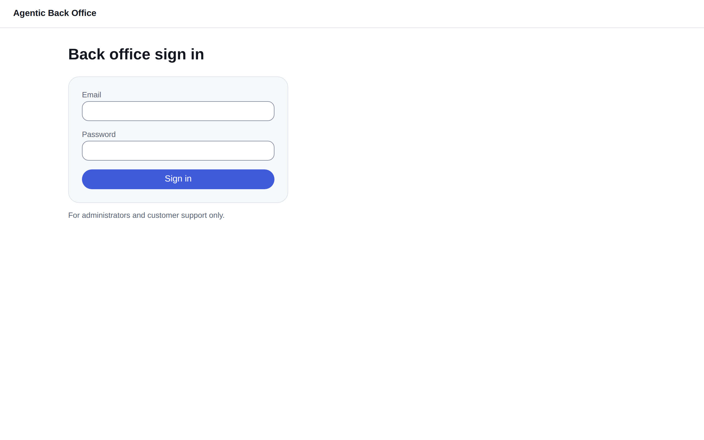
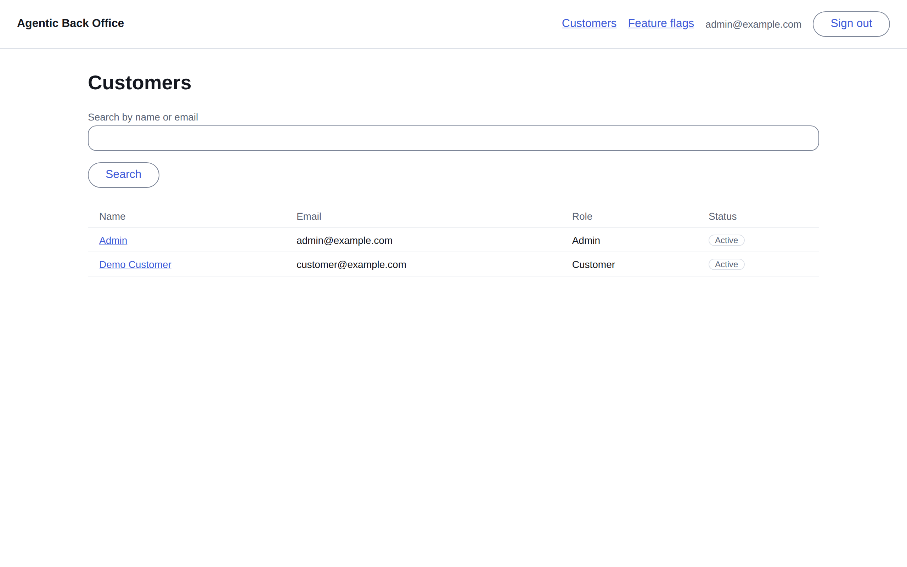
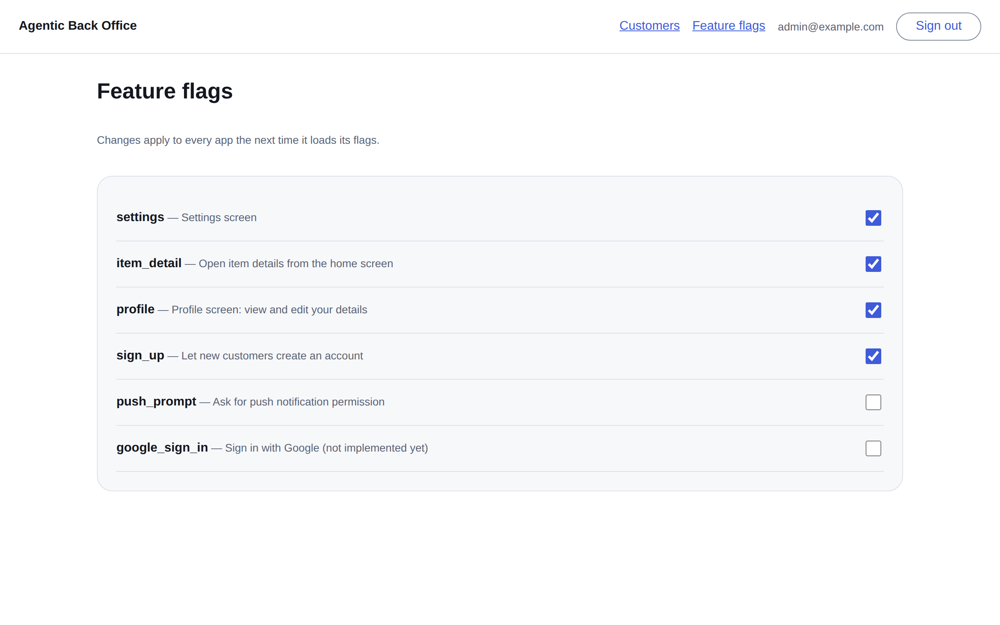

# Back office

Internal tool for administrators and customer support: find, edit, disable and delete customers, and switch feature flags for every app. Part of the [Agentic Product Starter](../../README.md).

React + TypeScript (Vite). Uses the shared colour palette from `design/tokens.json` and the .NET backend.

## Screenshots

| Sign in | Customers | Feature flags |
|---|---|---|
|  |  |  |

Taken automatically by the [Screenshots workflow](../../.github/workflows/screenshots.yml) from the SYST build with test data; they refresh whenever the app changes.

## Run it

Requires Node 22 and the [.NET 10 SDK](https://dotnet.microsoft.com/download) for the backend.

```bash
# terminal 1: backend
cd backend && dotnet run --project src/AgenticProduct.Api --launch-profile Dev

# terminal 2: Back office
cd apps/back-office
npm install
npm run dev            # http://localhost:5174
```

Sign in with the seeded admin (`admin@example.com` / `Admin123!`). Customer accounts are refused.

## Commands

| Command | What it does |
|---|---|
| `npm run dev` | Dev environment on port 5174 |
| `npm run lint` | ESLint, warnings fail |
| `npm run typecheck` | TypeScript strict mode |
| `npm test` | Unit tests (Vitest + Testing Library) |
| `npm run test:coverage` | Unit tests with the 70% line coverage gate |
| `npm run e2e` | End-to-end tests (Playwright): starts the backend in SYST and the built app on port 4174 |
| `npm run build` | Production build (Prod environment) |

## Structure

```
src/
├── api/            # client.ts (fetch, errors) + endpoints.ts (every backend call)
├── auth/           # Session state and token storage
├── features/       # One folder per screen
├── ui/             # Design-system components: Button, TextField, Card, Alert, Page
├── styles/         # tokens.css (generated) + global.css (built only from tokens)
└── test/           # Test setup and a fake API
e2e/                # Playwright end-to-end tests
```

## Environments

`src/config/env.ts` holds the backend URL per environment (`VITE_API_BASE_URL` can override it at build time). `npm run dev` uses Dev, end-to-end tests use SYST, `npm run build` uses Prod.
