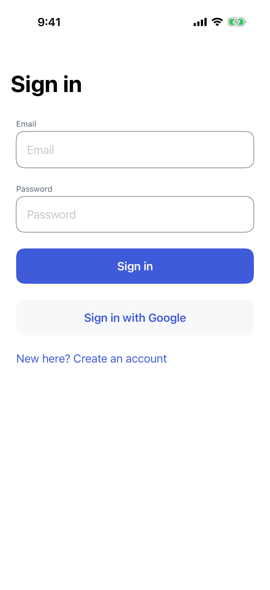
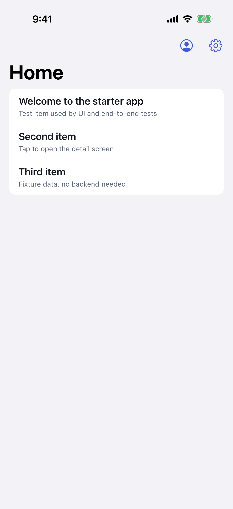
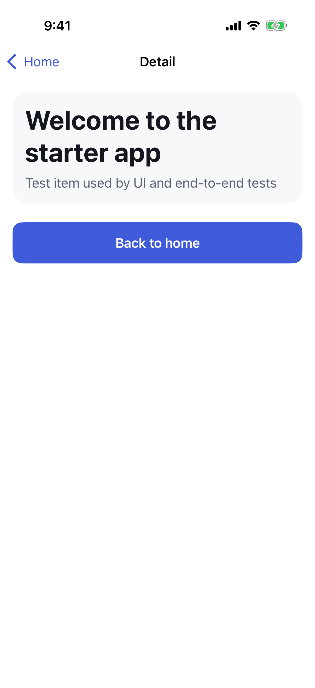
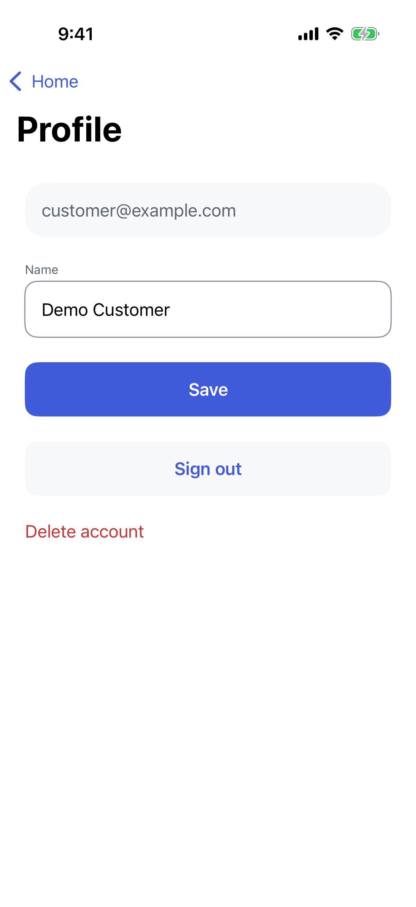
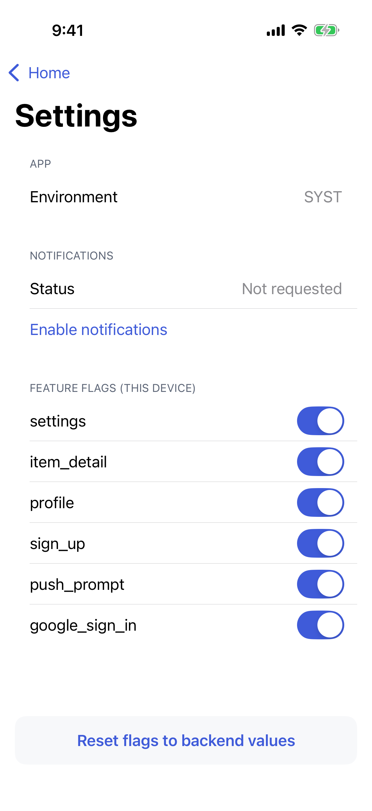

# iOS app – tutorial

Part of the [Agentic Product Starter](../../README.md).

SwiftUI app with sign up, sign in, profile and sign out against the .NET backend, the shared design tokens, navigation, a REST API layer, feature flags, push notifications, a Google sign-in skeleton, and unit, UI and end-to-end tests gated by CI.

## Screenshots

| Sign in | Home | Detail | Profile | Settings |
|---|---|---|---|---|
|  |  |  |  |  |

Taken automatically by the [Screenshots workflow](../../.github/workflows/screenshots.yml) from the SYST build with test data; they refresh whenever the app changes.

## 1. One-time setup (Mac)

1. Install Xcode 16 or newer from the App Store and open it once.
2. Install Homebrew if you don't have it: https://brew.sh
3. From the repo, go to the iOS folder and install the tools:

```bash
cd apps/ios
make bootstrap   # XcodeGen, SwiftLint, typos, Maestro
make open        # generates AgenticApp.xcodeproj and opens Xcode
```

The Xcode project is generated from `project.yml` and is not committed. Run `make generate` after pulling changes that add or move files.

## 2. Run the app

- Start the backend first: `cd backend && dotnet run --project src/AgenticProduct.Api --launch-profile Dev`.
- In Xcode pick the `AgenticApp` scheme and an iPhone simulator, then press Run. Sign in with `customer@example.com` / `Customer123!` or create an account.
- `Run` uses the **Dev** environment. Tests use **SYST**. Archives use **Prod**.
- To try it without the backend, edit the scheme → Run → Arguments → add `-uiTesting`. The app then uses the JSON fixtures and any sign-in works.

## 3. What's inside

```
apps/ios/
├── project.yml              # Xcode project definition (XcodeGen)
├── Config/                  # Dev.xcconfig, Syst.xcconfig, Prod.xcconfig
├── AgenticApp/
│   ├── App/                 # Entry point, AppContainer (wiring), RootView, environments
│   ├── DesignSystem/        # Theme tokens + DS components
│   ├── Core/
│   │   ├── Networking/      # APIClient, Endpoint, Endpoints, FixtureAPIClient
│   │   ├── FeatureFlags/    # FeatureFlag, FeatureFlagService, FeatureGate
│   │   ├── Navigation/      # Route, Router
│   │   ├── Auth/            # SessionStore (who is signed in), TokenStore (Keychain)
│   │   └── Services/        # Repositories, AuthService, push notifications
│   ├── Features/            # Auth (sign in/up), Home, Detail, Profile, Settings (View + ViewModel)
│   └── Resources/Fixtures/  # Test data JSON
├── AgenticAppTests/            # Unit tests
├── AgenticAppUITests/          # UI tests (XCUITest)
├── e2e/flows/               # End-to-end tests (Maestro)
├── scripts/                 # Coverage gate
├── Makefile                 # All commands
└── .agents/skills/          # iOS skills for AI agents
```

### Environments

Each environment has its own app name, bundle ID, API URL and push setting in `Config/*.xcconfig`, so Dev, SYST and Prod apps can sit side by side on one phone. Dev points at the local backend (`http://localhost:5080`); set the SYST and Prod URLs when you deploy the backend.

### Design system

Colours and spacing come from `design/tokens.json` at the repo root, shared with the web app, back office and website. Edit that file and run `node design/build.mjs`; `DesignTokens.swift` is regenerated and the whole app follows. Screens never hard-code styles.

### Accounts

Sign up, sign in, profile (edit name, delete account) and sign out use the backend's `/api/auth` and `/api/me` endpoints. The token is kept in the Keychain and the session is restored on launch. The flow matches the web app.

### Navigation

`Router` owns the navigation stack. Screens call `router.push(.settings)`, `router.pop()` or `router.popToRoot()`. New screens get a `Route` case and are mapped in `RootView`.

### REST API

Add endpoints to `Endpoints` and call them from a repository. The app uses the real backend normally and bundled JSON fixtures when launched with `-uiTesting`.

### Feature flags

Every feature can be switched on or off:

- **Backend:** `GET /feature-flags` returns `{ "flags": { "settings": true } }`.
- **Device:** in Dev and SYST builds, Settings has a toggle per flag.
- **Tests:** launch with `-FF_settings NO`.
- **In code:** wrap UI in `FeatureGate(.settings) { … }`.

### Push notifications

Settings → Enable notifications asks for permission and registers for push. To receive real pushes you need an Apple Developer account, the Push Notifications capability on the App ID, and the device token sent to the backend (see the note in `PushNotificationService`).

### Google sign-in

The "Sign in with Google" button sits on the sign-in screen behind the `google_sign_in` flag (off by default). `RemoteAuthService.signInWithGoogle()` returns "not implemented" for now. Later: add the GoogleSignIn package, get a Google token, and exchange it with a backend endpoint for an access token.

## 4. Run the tests

```bash
make lint        # SwiftLint, warnings fail
make typos       # spelling in code and docs
make test-unit   # unit tests + coverage gate (70% of logic)
make test-ui     # UI tests on the simulator
make e2e         # Maestro end-to-end flows on the simulator (sign in, navigation, settings, profile)
make ci          # all of the above
```

The tests use the newest iPhone simulator installed. To pick one: `make test-ui SIM_ID=<udid>` (see `xcrun simctl list devices`).

## 5. Daily workflow for a story

1. Create a branch from `main`: `feature/<story-id>-short-name`.
2. Ask the agent to implement the story. It follows `AGENTS.md` and the skills in `.agents/skills/`.
3. Add or update unit tests, a UI test and a Maestro flow.
4. Run `make ci`.
5. Push and open a pull request. CI runs: **iOS lint**, **iOS spelling**, **iOS unit tests and coverage**, **iOS UI tests**, **iOS end-to-end tests**.
6. Merge only when everything is green.

## 6. Block merging until checks pass (one-time, on GitHub)

1. Repo → Settings → Rules → Rulesets → New branch ruleset.
2. Target: the default branch (`main`).
3. Turn on: *Require a pull request before merging*, *Require status checks to pass* (add the five iOS checks after they have run once), *Block force pushes*.
4. Save as **Active**.

Note: on a free GitHub plan, rulesets and branch protection are only enforced on **public** repos. For a private repo you need GitHub Pro or Team.

Also note: macOS CI runners use GitHub Actions minutes at a higher rate than Linux, so watch usage on a private repo.
