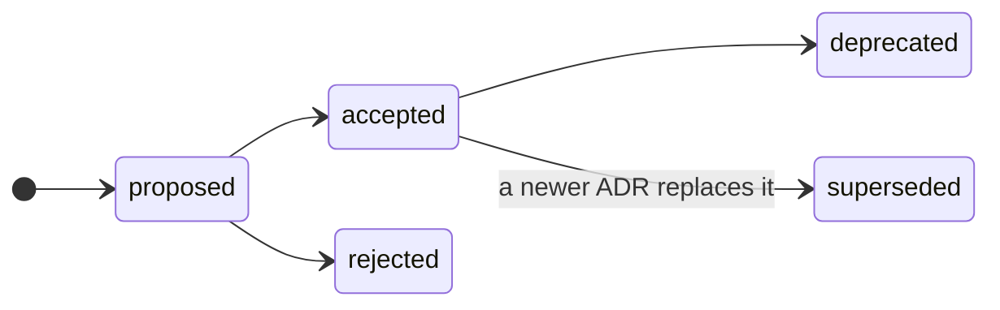

# Architecture decision records

Decisions that are hard to reverse, would surprise a future reader, and came from a real trade-off. Written in [MADR 4](https://adr.github.io/madr/) format. Start with the [architecture overview](../architecture/README.md) for the big picture.

| ADR | Decision | Status | Date |
|---|---|---|---|
| [0001](0001-monorepo-with-shared-and-platform-skills.md) | One monorepo with shared and platform skills | Accepted | 2026-11-14 |
| [0002](0002-ios-app-architecture.md) | iOS app: SwiftUI with MVVM, a composition root and a router | Accepted | 2026-11-14 |
| [0003](0003-shared-design-tokens.md) | One set of design tokens generated for every app | Accepted | 2026-11-14 |
| [0004](0004-backend-and-web-stack.md) | .NET backend and React web apps | Accepted | 2026-11-14 |
| [0005](0005-android-app-architecture.md) | Android app: Jetpack Compose mirroring the iOS architecture | Accepted | 2026-11-14 |
| [0006](0006-architecture-documentation.md) | Document architecture with MADR, arc42 and C4 | Accepted | 2026-11-14 |
| [0007](0007-dependency-security-and-updates.md) | Dependency security and updates with GitHub, OSV and Dependabot | Accepted | 2026-11-14 |
| [0008](0008-observability.md) | Observability with OpenTelemetry, Grafana and Sentry | Accepted | 2026-11-15 |
| [0009](0009-third-party-configuration.md) | Third-party settings in .env.local and GitHub Environments | Accepted | 2026-11-15 |
| [0010](0010-dora-metrics.md) | Measure delivery with DORA metrics from GitHub data | Accepted | 2026-11-15 |

## When to write one

All three must be true (from Matt Pocock's `domain-modeling` skill):

1. **Hard to reverse:** changing your mind later is costly.
2. **Surprising without context:** someone reading the code would ask "why this way?"
3. **A real trade-off:** there were genuine alternatives.

Typical examples: a database or message bus, an auth provider, an integration pattern between apps and backend, a new platform, a deliberate deviation from the obvious path, a constraint that is not visible in the code.

## How

1. Copy [`template.md`](template.md) to `NNNN-short-title.md` (next free number).
2. Fill it in with `status: proposed` and open a pull request; the discussion happens there.
3. When merged, set `status: accepted`, add a row to the table above, and update the [architecture overview](../architecture/README.md) if the picture changed.
4. Never edit the decision of an accepted ADR. To change it, write a new ADR and set the old one to `superseded by ADR-NNNN`.

The `architecture-decisions` skill (`.agents/skills/architecture-decisions/`) walks an agent through this.

## Lifecycle

