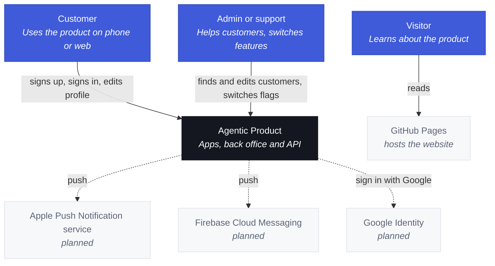
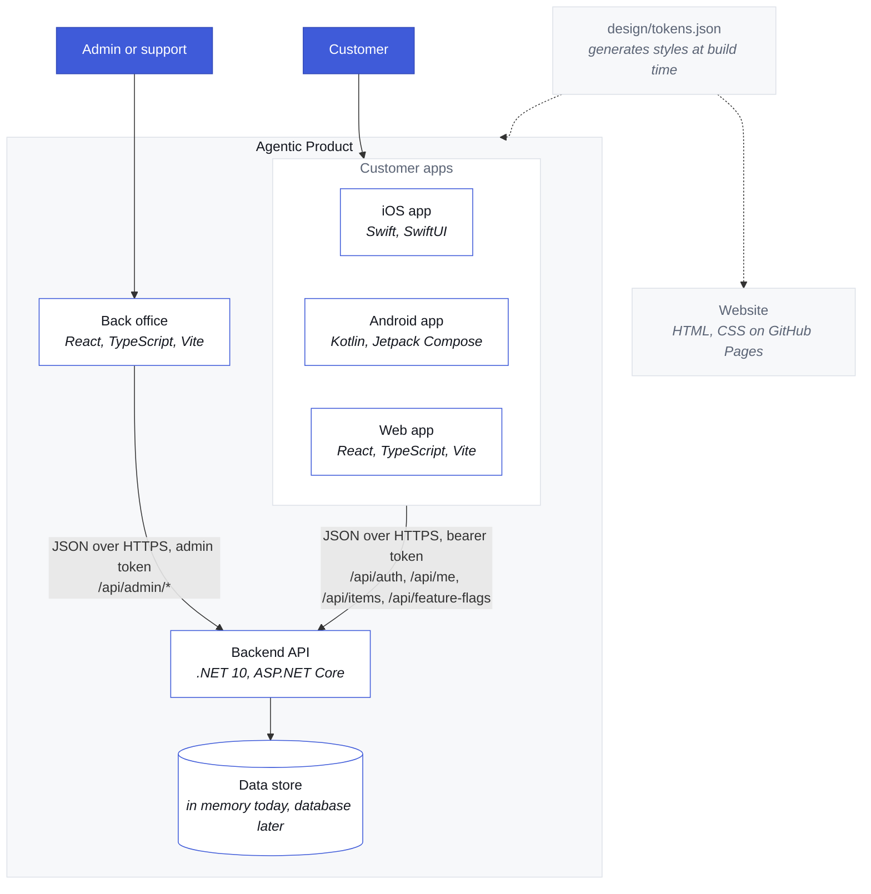
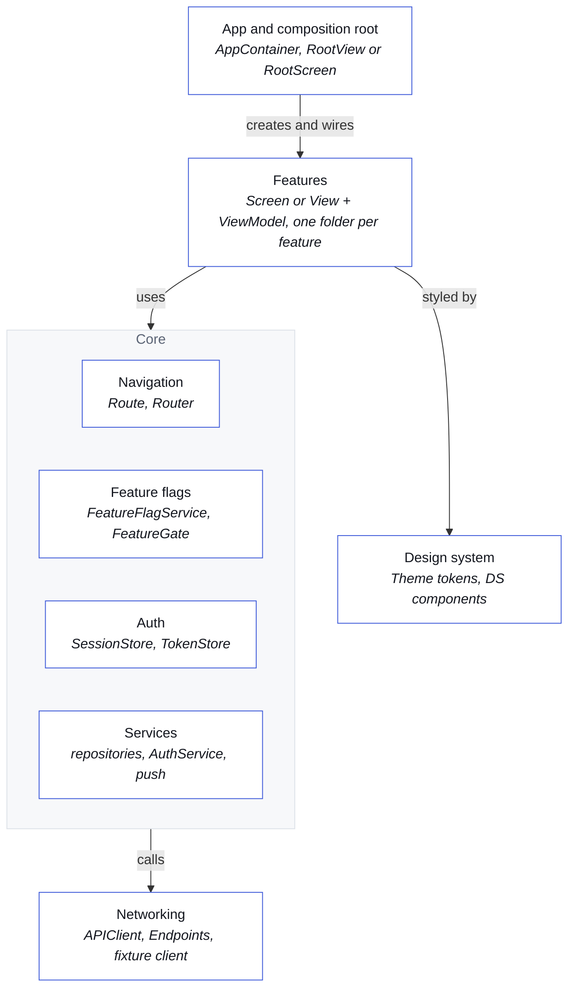
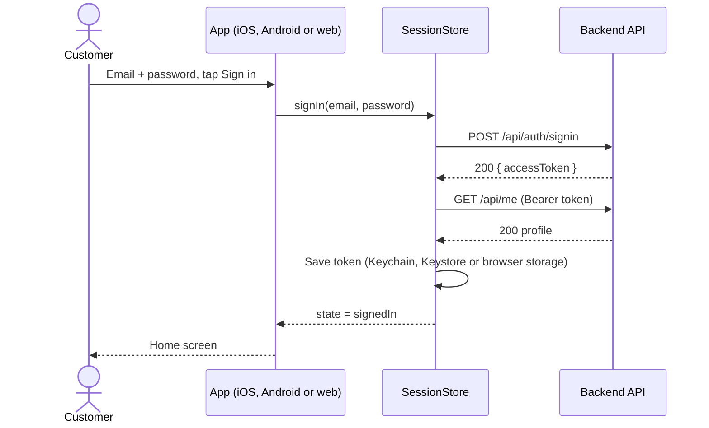
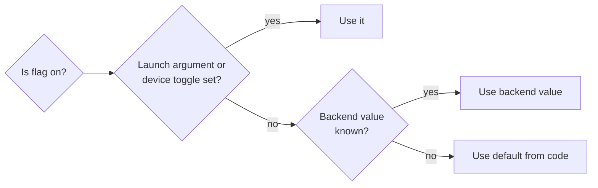

# Architecture overview

The big picture of the Agentic Product Starter in [arc42](https://arc42.org) sections, with [C4](https://c4model.com) diagrams. Read this before changing how parts of the system fit together; read the [ADRs](../adr/README.md) for why. Keep it short and true: update it in the same pull request as the change.

## 1. Goals

The starter is the base for a new product built with AI agents: the same account flow on every platform, one design system, and every change tested before it ships.

| Quality goal | What it means here |
|---|---|
| **Consistency** | One flow, one palette, one set of feature flags and test IDs across iOS, Android and web |
| **Changeability** | Agents add a feature by following one checklist per platform; decisions are written down |
| **Testability** | Every app runs on test data with no backend; CI blocks merges unless all checks pass |
| **Security** | Tokens stored in the Keychain or Keystore, HTTPS outside Dev, no secrets in the repo |

## 2. Constraints

* Public repository on the GitHub free plan: no secrets, CI on GitHub Actions, `main` protected by a ruleset.
* Three environments everywhere: **Dev**, **SYST** (system test) and **Prod**. Tests run against SYST.
* Runs locally with no cloud account or database ([ADR-0004](../adr/0004-backend-and-web-stack.md)).
* Native mobile apps, not cross-platform ([ADR-0002](../adr/0002-ios-app-architecture.md), [ADR-0005](../adr/0005-android-app-architecture.md)).

## 3. Context (C4 level 1)

Who uses the product and which outside systems it depends on.

Dotted lines are skeletons: the code paths exist but need an account and keys before they work.

## 4. Solution strategy

| Concern | Approach | Decision |
|---|---|---|
| Repository | One monorepo; shared skills at the root, platform skills per app | [ADR-0001](../adr/0001-monorepo-with-shared-and-platform-skills.md) |
| Mobile | Native SwiftUI and Jetpack Compose with the same MVVM layers and names | [ADR-0002](../adr/0002-ios-app-architecture.md), [ADR-0005](../adr/0005-android-app-architecture.md) |
| Look and feel | One `design/tokens.json`, generated per platform | [ADR-0003](../adr/0003-shared-design-tokens.md) |
| Backend and web | ASP.NET Core minimal APIs; React + TypeScript web apps | [ADR-0004](../adr/0004-backend-and-web-stack.md) |
| Documentation | MADR, arc42 and C4, next to the code | [ADR-0006](../adr/0006-architecture-documentation.md) |

## 5. Building blocks

### 5.1 Repository

| Folder | Holds |
|---|---|
| `apps/ios`, `apps/android` | Customer mobile apps |
| `apps/web-app` | Customer web app |
| `apps/back-office` | Admin and support tool |
| `apps/website` | One-page landing site |
| `backend` | API for every app |
| `design` | Design tokens and generator |
| `docs` | Product context, architecture, ADRs, agent setup |
| `.agents/skills`, `*/.agents/skills` | Shared and platform skills |

### 5.2 Containers (C4 level 2)

### 5.3 Inside the mobile apps

iOS and Android use the same layers and the same names, so one story reads the same on both.

| Rule | Why |
|---|---|
| Only the composition root creates concrete classes | Tests and fixtures swap implementations in one place |
| View models depend on interfaces, never on HTTP clients | Unit tests need no network |
| Screens navigate only through `Router` | Navigation is testable and screens stay independent |
| Styling only from design-system tokens | Restyle every app from `design/tokens.json` |

### 5.4 Inside the backend

| Folder | Responsibility |
|---|---|
| `Endpoints/` | HTTP routes: Auth, Profile, Admin, Public |
| `Auth/` | `AccountService` (rules), tokens, current-user filter |
| `Data/` | Repository interfaces and in-memory implementations, seed data |
| `Domain/` | `User`, `FeatureFlag`, `Item` |
| `Contracts/` | Request and response records |

## 6. Runtime view

### Sign in

On launch, the app reads the saved token and calls `GET /api/me`. If the backend rejects it, the token is dropped and the user sees Sign in. Sign out calls `POST /api/auth/signout`, which invalidates every token of that user.

### Feature flag resolution

Admins switch flags in the back office (`PUT /api/admin/feature-flags/{key}`); apps pick them up on their next `GET /api/feature-flags`.

## 7. Deployment and environments

| | Dev | SYST | Prod |
|---|---|---|---|
| Used for | Local development | CI, UI and end-to-end tests | Customers |
| Backend | `http://localhost:5080` | Local in CI; URL set when deployed | Set when deployed |
| Mobile build | iOS `Dev` config, Android `dev` flavor | `Syst` / `syst` | `Prod` / `prod` |
| Seeded test accounts | Yes | Yes | Never |
| Local feature-flag toggles | Yes | Yes | No |

The website deploys to GitHub Pages on every merge to `main`. The backend, web apps and mobile apps have no hosting yet; adding it deserves an ADR.

## 8. Cross-cutting concepts

### 8.1 Authentication

Bearer tokens from ASP.NET Core. Sign-out invalidates all of a user's tokens through a security stamp. Admin endpoints require the `Admin` role. Mobile apps keep the token in the Keychain (iOS) or encrypted with an Android Keystore key; it is excluded from backups.

### 8.2 Feature flags

One list of keys (`settings`, `item_detail`, `profile`, `sign_up`, `push_prompt`, `google_sign_in`) shared by the backend, every app and the test fixtures. New and unfinished work ships behind a flag that defaults to off.

### 8.3 Design tokens

`design/tokens.json` generates `tokens.css` (web apps, website), `DesignTokens.swift` (iOS) and `DesignTokens.kt` (Android). Apps never hard-code colours or spacing.

### 8.4 Errors

The API returns problem details; validation errors list each field. Apps show field errors next to the field and a plain message otherwise.

### 8.5 Testing and test data

Each app has unit, UI and end-to-end tests. Mobile UI and end-to-end tests run on bundled JSON fixtures (the same files on iOS and Android) with the same test IDs. Web end-to-end tests run against the real backend in SYST.

## 9. Decisions

All decisions are in [`docs/adr`](../adr/README.md). Each one names the check that enforces it under **Confirmation**.

## 10. Quality gates

Every pull request runs the checks of the parts it touches, and the `main` ruleset blocks merging until all pass: lint and spelling, unit tests with 70% coverage, UI tests, end-to-end tests, and design tokens in sync. See the [README](../../README.md#quality-gates).

## 11. Risks and technical debt

| Item | Impact | Next step |
|---|---|---|
| In-memory data store | Data resets on restart | Add a database behind the repository interfaces (needs an ADR) |
| Push notifications are a skeleton | No real pushes | APNs key, Firebase project, device-token endpoint |
| Google sign-in is a skeleton | Button behind a flag, returns "not implemented" | Google client IDs and a token-exchange endpoint |
| No hosting for backend and apps | SYST and Prod URLs are placeholders | Choose hosting (needs an ADR) |
| No token refresh | Users sign in again when a token expires | Refresh tokens when sessions get longer |

## 12. Glossary

Domain terms live in `GLOSSARY.md` at the repo root, created by the `domain-modeling` skill when the first term is settled.

## Diagrams

The diagrams above are Mermaid, so GitHub renders them and pull requests show changes as text. For an interactive, shareable version (zoom, click-through, export to image), use the optional [Archify](https://github.com/tt-a1i/archify) skill; see `.agents/skills/architecture-decisions/SKILL.md`.
